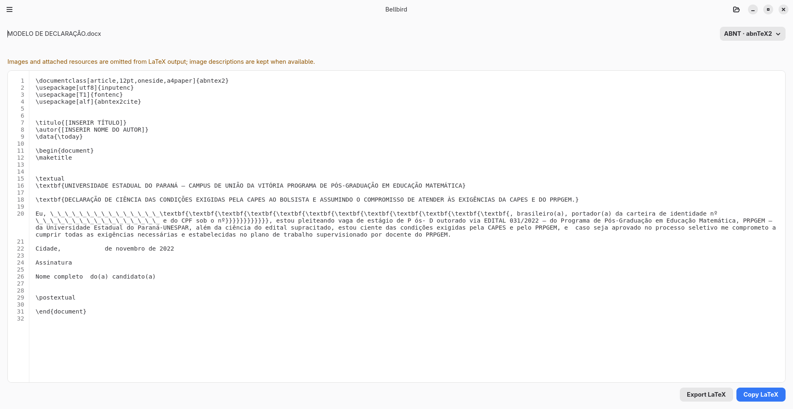
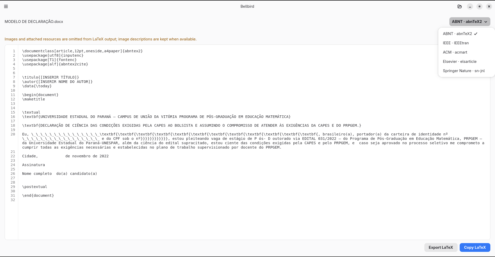

  

<h1 align="center">Bellbird</h1>

An offline GNOME app that converts supported documents into structured LaTeX. It processes files locally and exports a single <code>.tex</code> file.

  <a href="https://github.com/diegopn/bellbird/releases/latest">Download</a> ·
  <a href="https://diegopn.github.io/bellbird-site/">Website</a> ·
  <a href="https://diegopn.github.io/bellbird-site/manual/">User manual</a>

  
  
  

Bellbird converts documents to structured LaTeX locally. It prepares the source for editing in a LaTeX application.

## At a glance

| Input | Templates | Result |
| --- | --- | --- |
| `.doc`, `.docx`, `.epub`, `.htm`, `.html`, `.markdown`, `.md`, `.odt`, `.org`, `.rst`, `.tex`, `.txt` | ABNT, IEEE, ACM, Elsevier, Springer Nature | One editable `.tex` file, ready to copy or export |

Bellbird uses author information from the source when available. It does not compile PDFs or export separate image or bibliography files; image descriptions are kept as text when available.

## Screenshots

<table>
  <tr>
    <td align="center"><strong>Document conversion</strong></td>
    <td align="center"><strong>Publication format selection</strong></td>
  </tr>
  <tr>
    <td></td>
    <td></td>
  </tr>
</table>

## Build from source

See [BUILDING.md](BUILDING.md) for Linux dependencies and development commands on Fedora, Debian/Ubuntu, Arch, and openSUSE.

## Contributing

See [CONTRIBUTING.md](CONTRIBUTING.md) for ways to report problems, test the app, improve translations, or contribute code and documentation.

## Support

Sponsorship supports Bellbird development, maintenance, documentation, and releases.

  

## License

GPL-3.0-or-later. See [LICENSE](LICENSE).
